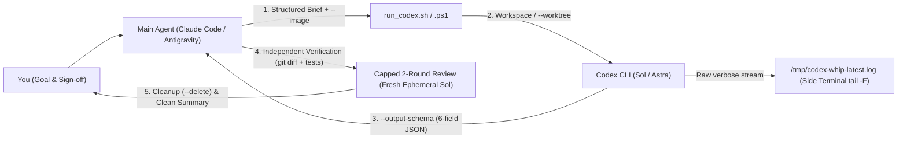

# codex-whip

English | [中文文档](./README_zh.md)

**Tame the OpenAI Codex CLI into a silent, schema-locked execution worker for Claude Code & Google Antigravity.**

> Use your primary agent (**Claude Opus** or **Gemini 4 Neon**) to plan, verify, and talk to you — whip **Codex (`gpt-6.2-sol` / `gpt-6.2-astra`)** to burn your Pro quota on heavy execution and capped independent reviews, without its rambling prose polluting your main conversation.

---

## Why `codex-whip`?

If you subscribe to Codex Pro alongside Claude Code or Antigravity, you've probably hit these exact frustrations:
- **Verbose / rambling output** from Codex pollutes your main agent's context window.
- **Noisy history bloat** — automated runs clutter your Codex CLI/App conversation sidebar.
- **Context rot vs. rework** — one-off calls lose memory during a multi-step milestone, while endless sessions degrade.
- **Infinite review ping-pong** — models nitpick formatting forever instead of stopping at real bugs.
- **Heavy frameworks** — you don't want a persistent MCP daemon or database just to delegate tasks to `codex exec`.

`codex-whip` solves all of them with **zero background servers** and **~200 lines of portable shell/PowerShell + a strict JSON Schema + a battle-tested `SKILL.md`**.

---

## Architecture



---

## Key Features

- **Context-Pollution Proof**: Raw Codex stdout/stderr streams to `/tmp/codex-whip-latest.log` (watch live in a side terminal via `tail -F`), while your main agent receives **only** a strict 6-field JSON receipt (`status`, `summary`, `files_changed`, `checks`, `evidence_refs`, `risks_or_open_questions`).
- **Dual-Orchestrator Shared Ledger**: One symlink installs for **both Antigravity and Claude Code** sharing `~/.codex-whip/sessions.tsv`. Start a named milestone (`--label auth-v2`) in Antigravity, switch to Claude Code, and resume `"auth-v2"` by name — no UUID copy-pasting.
- **Clean History Lifecycle**:
  - One-off tasks & reviews run `--ephemeral` (zero history clutter).
  - Milestones run `--persist --label <name>`, resume by name/UUID (auto-restoring workdir), and clean up via `--delete <name>` or `--cleanup-all`.
- **Safe Isolation (`--worktree`)**: Automatically implies `--persist` and prints `codex_workdir` so your main agent can audit `git diff` in an isolated worktree before touching your working tree.
- **Capped 2-Round Independent Review**: Fresh ephemeral `sol` reviewer, Blocker/Major findings only, hard cap at 2 rounds to stop nitpick loops.
- **Built-in Guardrails & Telemetry**: Process-group `--timeout` (default `600s`, exit `124`), `codex_duration_sec` & `codex_tokens` per run, repeatable `--image` forwarding, and one-command interactive takeover (`open_codex.sh` / `open_codex.ps1`).
- **Cross-Platform**: macOS / Linux (`bash` + `python3`) and Windows (`PowerShell`, UTF-8 clean, non-admin Junction install).

---

## Quick Start

### Prerequisites
- Local [OpenAI Codex CLI](https://github.com/openai/codex) installed and signed in (auto-detected from `PATH`, macOS ChatGPT Desktop bundle, or `CODEX_BIN`).
- Google Antigravity and/or Claude Code.

### Install (macOS / Linux)

```bash
git clone https://github.com/EddyHai57/codex-whip.git
cd codex-whip
./install.sh          # symlinks into both Antigravity & Claude Code
# or pick one: ./install.sh --antigravity  |  ./install.sh --claude
```

### Install (Windows PowerShell)

```powershell
git clone https://github.com/EddyHai57/codex-whip.git
cd codex-whip
.\install.ps1         # creates non-admin directory junctions for both tools
# or pick one: .\install.ps1 -Antigravity  |  .\install.ps1 -Claude
```

### Watch Live Output in a Side Terminal (Optional)

- **macOS / Linux**:
  ```bash
  tail -F /tmp/codex-whip-latest.log
  ```
- **Windows PowerShell**:
  ```powershell
  Get-Content "$env:TEMP\codex-whip-latest.log" -Wait
  ```

---

## Usage Examples

Once installed, just talk naturally in Antigravity or Claude Code:

- **Delegate a milestone**: *"Have Codex read the billing module first (label it `billing-v2`), don't edit anything yet."*
- **Resume by name (even in a new chat or the other tool)**: *"Continue the `billing-v2` Codex session and implement the retry logic we agreed on."*
- **Heavy debugging with Astra + screenshot**: *"Send this screenshot to Astra (`xhigh`) and find why the chart layout breaks."*
- **Isolated refactor**: *"Run Codex in a `--worktree` to refactor the data pipeline; inspect the diff before merging."*
- **Take over interactively**: *"Open the `billing-v2` Codex session in Terminal."*
- **Clean up**: *"Milestone verified — delete `billing-v2`"* or *"Clean up all tracked Codex sessions."*

### Direct CLI Reference (`run_codex.sh`)

```bash
# Ephemeral one-off run (default: gpt-6.2-sol, effort=high, workspace-write)
./skill/scripts/run_codex.sh --cd /path/to/repo --prompt-file /tmp/brief.md

# Named milestone with Astra + image attachment
./skill/scripts/run_codex.sh --cd /path/to/repo --model astra --effort xhigh \
  --persist --label "bug-402" --image /tmp/error.png --prompt-file /tmp/brief.md

# Resume by name (exact or unique substring; auto-restores workdir)
./skill/scripts/run_codex.sh --resume "bug-402" --prompt-file /tmp/followup.md

# Inspect & clean tracked sessions
./skill/scripts/run_codex.sh --list-sessions
./skill/scripts/run_codex.sh --delete "bug-402"
./skill/scripts/run_codex.sh --cleanup-all

# Open interactive Codex TUI in Terminal (or copy command with --copy)
./skill/scripts/open_codex.sh --session "bug-402"
./skill/scripts/open_codex.sh --session "bug-402" --copy
```

---

## Harness Design Principles

1. **Hard constraints beat polite prompts**: Don't just ask Codex to "be brief" — lock its output with `--output-schema`, isolate edits with `--worktree`, and enforce timeouts at the OS process-group level.
2. **Evidence over claims**: The orchestrator never trusts a worker's summary blindly; it verifies real `git diff`, test exits, and `file:line` citations.
3. **Human-in-the-loop self-evolution**: Never let agents silently rewrite their own harness rules (which causes bloat and self-weakening gates). Capture real failures, promote recurring friction (≥ 2x) into script/schema gates, get human approval, re-test, and prune obsolete rules.

---

## License

[MIT](./LICENSE) © 2026 EddyHai57
