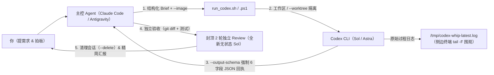

# codex-whip

[English](./README.md) | 中文文档

**把本地 OpenAI Codex CLI 驯化成静默、强约束的执行工蜂，供 Claude Code 与 Google Antigravity 统一调度。**

> 由你喜欢的主控 Agent（**Claude Opus** 或 **Gemini 4 Neon**）负责思考规划、验收和与你对话；**鞭策 Codex（`gpt-6.2-sol` / `gpt-6.2-astra`）**吃满你的 Pro 订阅额度去干重活、做独立审查，同时彻底挡住它的“怪话”和历史垃圾，绝不污染主对话上下文。

---

## 为什么做 `codex-whip`？

同时用着 Codex Pro 和 Claude Code / Antigravity 时，最常见的 5 个痛点：
- **语料污染**：Codex 中间输出冗长、偶尔跑题说怪话，直接塞进主对话会稀释主模型注意力。
- **历史列表爆炸**：自动化派活把 Codex CLI / App 侧边栏塞满一次性临时记录。
- **记忆 vs 上下文腐烂（Context Rot）**：纯无状态返工太慢，一直用同一个会话又越聊越蠢。
- **无意义审查死循环**：模型被要求 review 时总想找点风格问题改，两个模型互相拉扯。
- **现有方案过重**：为了调个 `codex exec` 还要搭常驻 MCP 服务和数据库，维护成本太高。

`codex-whip` 用 **零常驻服务 + ~200 行跨平台脚本 + 严格 6 字段 JSON Schema + 工程化 `SKILL.md`** 一次性解决上面所有问题。

---

## 工作流架构



---

## 核心特性

- **防语料污染（两层输出）**：所有啰嗦日志落盘到 `/tmp/codex-whip-latest.log`（可在侧边终端实时 `tail -F` 围观），主 Agent 只收严格 6 字段 JSON 回执（`status`、`summary`、`files_changed`、`checks`、`evidence_refs`、`risks_or_open_questions`）。
- **双主控共享命名账本**：一套软链同时装进 **Antigravity 和 Claude Code**，共用 `~/.codex-whip/sessions.tsv`。在 Antigravity 起的 `auth-v2` 任务，换新对话或切到 Claude Code 直接喊名字就能续跑，无需记 UUID。
- **干净的会话生命周期**：
  - 单次任务 / 独立 Review 默认 `--ephemeral`，零历史残留；
  - 里程碑任务 `--persist --label <名称>`，支持按名精确/唯一模糊续跑（自动恢复原目录），验完 `--delete <名称>` 或 `--cleanup-all` 一键清空。
- **大改动隔离（`--worktree`）**：自动开启 `--persist` 并吐出 `codex_workdir`，改在独立 Git worktree 里，主 Agent 审完 diff 再合回主工作区。
- **封顶 2 轮独立 Review**：强制全新无状态 `sol` 审 diff，只报 Blocker/Major 缺陷，最多 2 轮，防鸡蛋里挑骨头循环。
- **内置护栏与成本观测**：进程组级 `--timeout`（默认 `570s`，低于 Claude Code 前台 Bash 的 600 秒上限；超时退出码 `124`）、每次自动汇报 `codex_duration_sec` 和 `codex_tokens`、支持多张 `--image` 原图直传、一键弹出终端接管交互（`open_codex.sh` / `open_codex.ps1`）。
- **全平台支持**：macOS / Linux（Bash + Python 3）与 Windows（PowerShell，UTF-8 无乱码，免管理员权限目录联接安装）。

---

## 3 步快速上手

### 前置条件
- **本机 OpenAI Codex CLI**（[openai/codex](https://github.com/openai/codex)），已安装并登录（`codex login`）。脚本直接调用 `codex exec` / `codex exec resume`，不走 Codex API，也不需要 MCP 服务。自动探测 `PATH`、macOS ChatGPT 桌面端内置路径，也支持 `CODEX_BIN` 环境变量。
  - 依赖的参数：`exec --output-schema -o --ephemeral --worktree -s --cd --color`、`exec resume -c -m -i`、`delete --force`、`archive`。最近一次验证版本 `codex-cli 0.171.0-alpha`，新版 CLI 可能改名。
  - 默认模型 `gpt-6.2-sol` / `gpt-6.2-astra` 需在你的账号下可用；否则用 `--model <id>` 或 `CODEX_WHIP_DEFAULT_MODEL` 改。
- `bash` 与 `python3`（macOS / Linux），或 PowerShell 5.1+（Windows）。
- Google Antigravity 和/或 Claude Code。

### 安装（macOS / Linux）

```bash
git clone https://github.com/EddyHai57/codex-whip.git
cd codex-whip
./install.sh          # 同时软链安装到 Antigravity 和 Claude Code
# 或只装一边：./install.sh --antigravity  |  ./install.sh --claude
```

### 安装（Windows PowerShell）

```powershell
git clone https://github.com/EddyHai57/codex-whip.git
cd codex-whip
.\install.ps1         # 免管理员权限同时接入 Antigravity 和 Claude Code
# 或只装一边：.\install.ps1 -Antigravity  |  .\install.ps1 -Claude
```

### 侧边终端实时围观 Codex 输出（可选）

- **macOS / Linux**：
  ```bash
  tail -F /tmp/codex-whip-latest.log
  ```
- **Windows PowerShell**：
  ```powershell
  Get-Content "$env:TEMP\codex-whip-latest.log" -Wait
  ```

---

## 日常怎么用

装好后，在 Antigravity 或 Claude Code 里直接用自然语言调度即可：

- **开启里程碑**：*「让 codex 先读一下计费模块，起名叫 `billing-v2`，先别改文件。」*
- **按名续跑（跨对话 / 跨工具通用）**：*「接着 `billing-v2` 那个 codex 会话，按我们刚聊的方案动手改。」*
- **发图找 Astra 查硬骨头**：*「把这张报错截图发给 astra（`xhigh`），定位一下根因。」*
- **大重构隔离**：*「用 `--worktree` 让 codex 重构数据链路，你先帮我看 diff 再决定合不合。」*
- **亲自接管终端**：*「帮我在终端里打开 `billing-v2` 那个 codex 对话。」*
- **里程碑收尾清理**：*「这块验完了，把 `billing-v2` 删掉」* 或 *「清理所有未删的 codex 会话。」*

---

## Harness 设计理念

1. **硬约束胜过口头提醒**：与其在 prompt 里求模型“请言简意赅、别乱改”，不如直接用 `--output-schema` 锁输出、用 `--worktree` 锁改动范围、用进程组超时锁挂死。
2. **只信真证据，不盲信口头汇报**：主控永远核验真实的 `git diff`、单测结果和 `file:line` 引用。
3. **人审闭环的受控自进化**：禁止 Agent 无人看管地自改规则（防止规则膨胀与自我放水）；只在真实踩坑重复 ≥ 2 次时，优先把经验升级为脚本/Schema 硬门禁，经人确认并重测后再定版，定期删掉过时补丁。

---

## 开源协议

[MIT](./LICENSE) © 2026 EddyHai57
